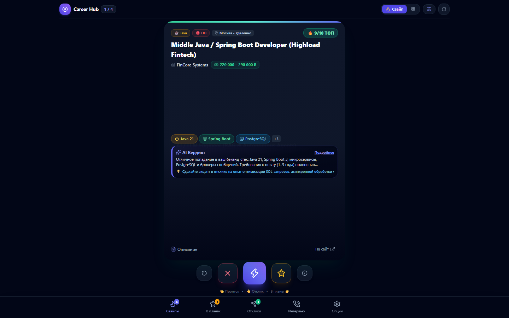
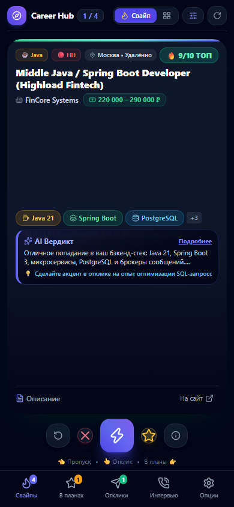
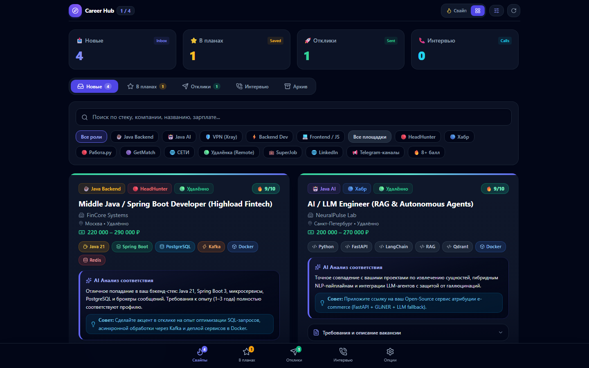
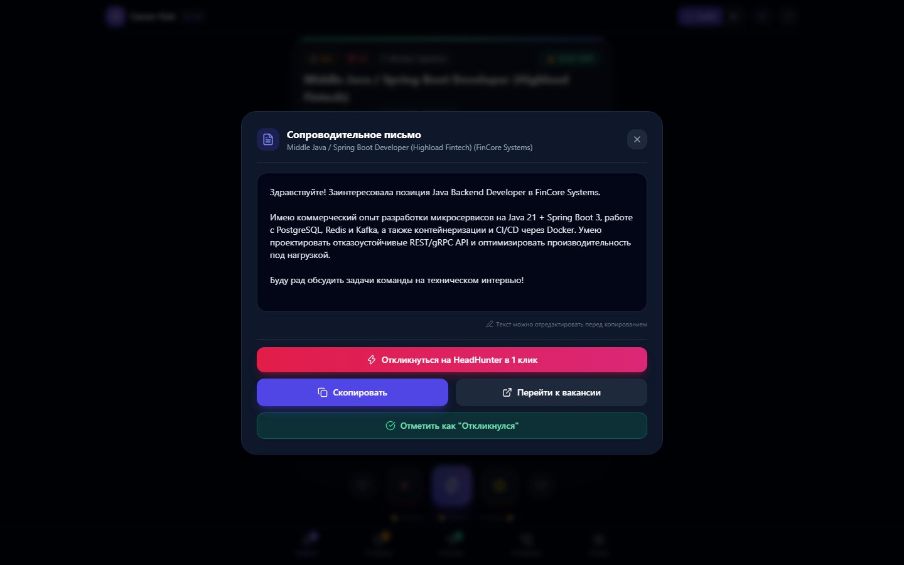
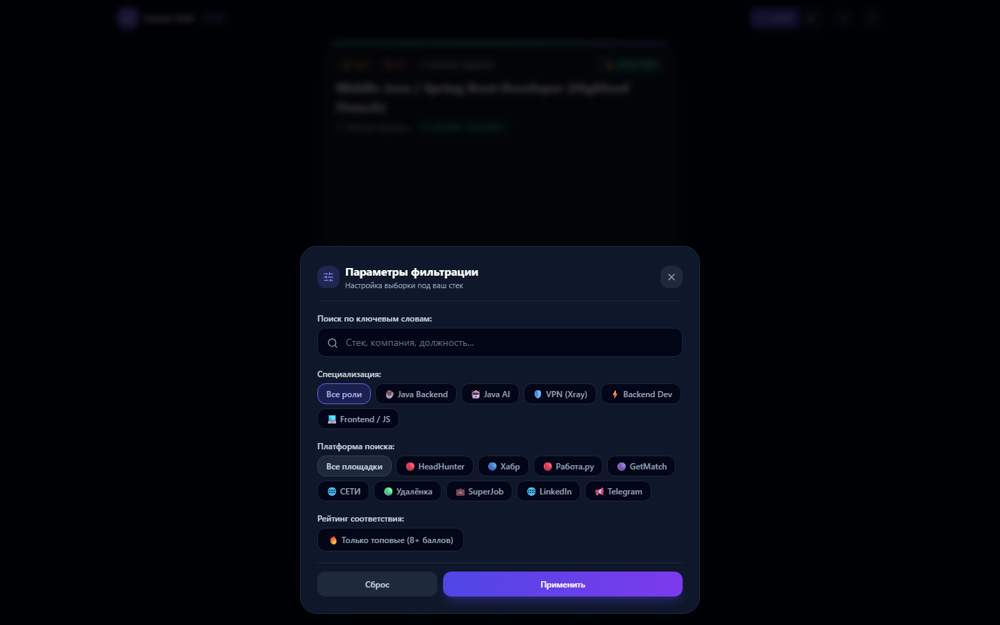
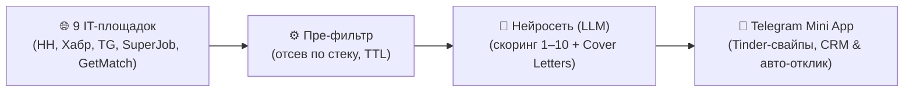

# 🎯 Career Hub AI — IT Job Discovery Engine & Application Copilot

[](https://www.python.org/)
[](https://github.com/nikitos7626/career-hub-bot)
[](https://core.telegram.org/bots/webapps)
[](https://www.docker.com/)
[](LICENSE)

Автономный мультиплатформенный агрегатор IT-вакансий, интеллектуальный скоринг на базе нейросетей (LLM), генератор персонализированных технических откликов и система сопровождения найма со встроенным веб-интерфейсом (**Telegram Mini App / Desktop SPA**).

---

## 📸 Интерфейс системы (Desktop & Telegram Mini App)

### Быстрый разбор вакансий свайпами (Tinder Mode) и AI-вердикты
| Режим свайпов (Desktop) | Telegram Mini App (Mobile) |
| :---: | :---: |
|  |  |

### Канбан-список, AI-генератор писем и гибкие фильтры
| Десктопный дашборд и статистика воронки | Персонализированный AI-отклик в 1 клик |
| :---: | :---: |
|  |  |

<details>
<summary>🔍 Посмотреть панель фильтрации по ролям и IT-площадкам</summary>
<br/>
<p align="center">
  
</p>
</details>

---

## 🏗️ Архитектура пайплайна



---

## 🌟 Ключевые возможности

### 1. Мультиплатформенный сбор данных
* **HeadHunter (hh.ru):** сбор вакансий по настраиваемым поисковым запросам с фильтрацией по грейдам (`noExperience`, `between1And3`).
* **Хабр Карьера:** мониторинг RSS-потоков по целевым техническим направлениям.
* **SuperJob, GetMatch & Работа.ру:** прямое взаимодействие с мобильными и открытыми API.
* **LinkedIn:** поиск по Guest API с автоматическим перехватом и экспоненциальной задержкой при `429 Too Many Requests`.
* **СЕТИ (vseti.app) и Remotive:** сбор международных и полностью удалённых вакансий.
* **Telegram IT-каналы:** мониторинг профильных каналов.

### 2. Интеллектуальная фильтрация и AI-скоринг
* **Быстрый пре-фильтр:** отсекает нерелевантные специализации и компании из черного списка до отправки в нейросеть.
* **Глубокий анализ соответствия (LLM):** оценивает стек вакансии по шкале от 1 до 10, определяет ключевую роль и формулирует аргументированный вердикт, на что обратить внимание при отклике.
* **Защита от информационного шума:** в Telegram приходят мгновенные уведомления только о топовых вакансиях (**8–10 баллов**). Остальные вакансии тихо попадают в базу Mini App без спама в чат.

### 3. Автоматизация откликов и сопроводительные письма
* **Контекстная генерация откликов:** нейросеть составляет лаконичные, деловые письма с фокусом на релевантный стек со ссылками на проекты и репозитории кандидата.
* **Мультиплатформенный авто-отклик:** подача откликов в 1 клик через веб-сессии **HeadHunter, Хабр Карьеры, SuperJob, GetMatch**, а также отправка по **Email / Telegram**.
* **Детекция форм и тестовых заданий:** при наличии обязательных опросников работодателя бот присылает прямую ссылку на прохождение теста.
* **Трекер переговоров и автоочистка:** автоматическое отслеживание приглашений и удаление неактуальных отказов (`DISCARD`) из профиля.

### 4. Веб-интерфейс и Telegram Mini App
* **Два режима работы:**
  * 🔥 **Tinder-свайпы (`Свайп`):** быстрая сортировка вакансий жестами на смартфоне или горячими клавишами (`←` Пропуск, `→` В планы, `↑` Отклик, `Space` Описание, `Ctrl+Z` Отмена).
  * 📋 **Канбан-список (`Список`):** подробные карточки со статистикой воронки (**Inbox, Saved, Applied, Calls, Archive**).
* **In-App управление сессиями:** прямо в интерфейсе Mini App можно проверить cookie/токены площадок, настроить порог скоринга и активировать автоматический режим.

---

## 🛠️ Стек технологий

* **Backend:** Python 3.12+, `asyncio`, `aiohttp`, `threading`, встроенный HTTP REST API сервер без тяжелых оверхедов.
* **AI & LLM:** Поддержка любых современных LLM (LLaMA 3.3, Qwen 2.5, DeepSeek, Mistral, GPT через OpenAI-совместимый API или Groq).
* **Frontend:** SPA на чистом JavaScript, Tailwind CSS (Dark Mode), Lucide Icons, Telegram WebApp SDK.
* **Инфраструктура & DevOps:** Docker, Docker Compose, Nginx, Cloudflare Tunnels, systemd.

---

## 🚀 Быстрый старт

### 1. Клонирование репозитория
```bash
git clone https://github.com/nikitos7626/career-hub-bot.git
cd career-hub-bot
```

### 2. Настройка переменных окружения
Скопируйте пример файла конфигурации:
```bash
cp .env.example .env
```
Заполните обязательные параметры:
```env
BOT_TOKEN=1234567890:ABCdefGHIjklMNOpqrSTUvwxYZ
CHAT_ID=123456789
ALLOWED_TELEGRAM_ID=123456789
GROQ_API_KEY=gsk_your_groq_api_key_here
```

*(Опционально)* Для детальной настройки запросов под свой стек можно скопировать и отредактировать JSON-конфигурацию:
```bash
mkdir -p data
cp bot_config.example.json data/bot_config.json
```

### 3. Запуск через Docker Compose
```bash
docker compose up -d --build
```

Сервис запустится и будет доступен:
* 🤖 **Telegram-бот:** прием команд, отправка дайджестов и пушей.
* 🌐 **Web Dashboard & Mini App:** `http://localhost:8088/` (или через ваш внешний домен/туннель).
