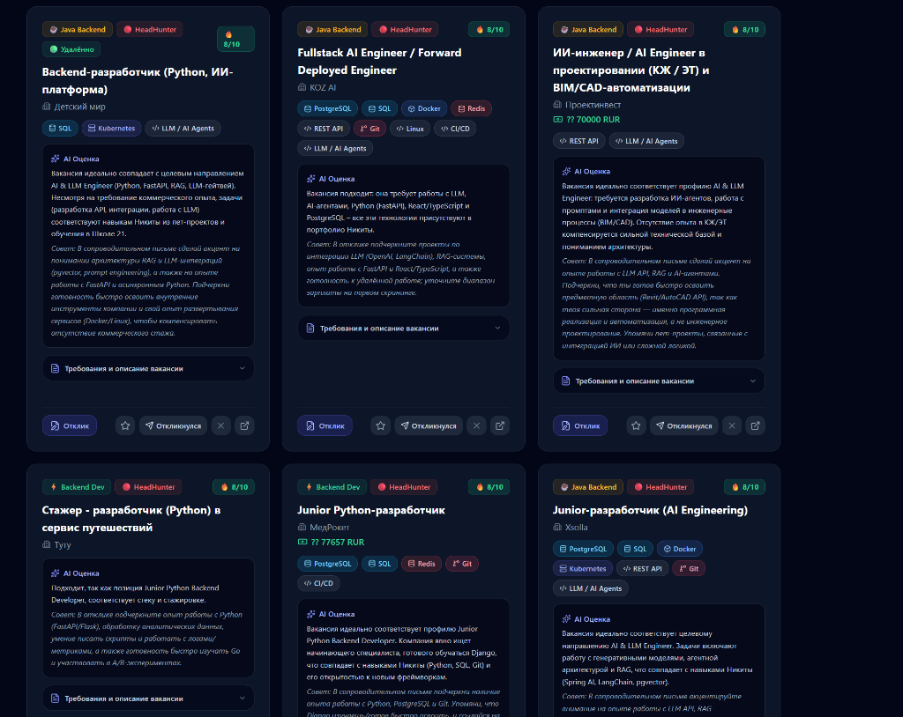
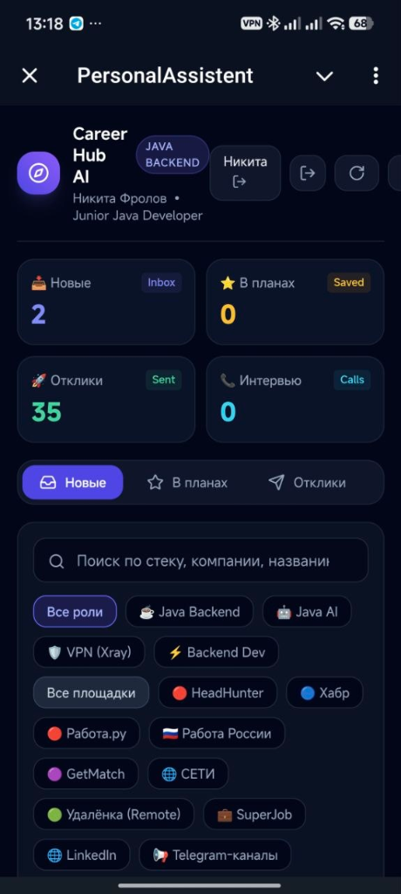
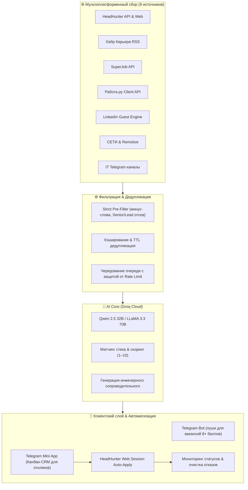

# 🎯 Career Hub AI — IT Job Discovery Engine & Application Copilot

[](https://www.python.org/)
[](https://groq.com/)
[](https://core.telegram.org/bots/webapps)
[](https://www.docker.com/)
[](LICENSE)

Автономный мультиплатформенный агрегатор IT-вакансий, интеллектуальный скоринг на базе открытых LLM (Groq Cloud), генератор персонализированных технических откликов и система сопровождения найма со встроенным веб-интерфейсом (**Telegram Mini App / Desktop SPA**).

---

## 📸 Интерфейс системы

<div align="center">
  
  <p><em>Десктопная панель управления: AI-скоринг вакансий (1–10), теги стека, вердикт модели и быстрые действия</em></p>
  <br/>
  
  <p><em>Адаптивный мобильный клиент внутри Telegram: воронка статусов (Inbox, Saved, Sent, Calls) и быстрые фильтры</em></p>
</div>

---

## 🏗️ Архитектура пайплайна



---

## 🌟 Ключевые возможности

### 1. Мультиплатформенный сбор данных
* **HeadHunter (hh.ru):** сбор вакансий по настраиваемым поисковым запросам с фильтрацией по грейдам (`noExperience`, `between1And3`).
* **Хабр Карьера:** мониторинг RSS-потоков по направлениям Java, Python, Backend, AI.
* **SuperJob & Работа.ру:** прямое взаимодействие с мобильными и открытыми API.
* **LinkedIn:** поиск по Guest API с автоматическим перехватом и экспоненциальной задержкой при `429 Too Many Requests`.
* **СЕТИ (vseti.app) и Remotive:** сбор международных и полностью удалённых вакансий.
* **Telegram IT-каналы:** мониторинг профильных каналов с поиском junior/intern позиций.

### 2. Интеллектуальная фильтрация и AI-скоринг
* **Быстрый пре-фильтр:** отсекает нерелевантные специализации (QA, дизайн, 1С, PHP, системное администрирование, Senior/Lead) и недобросовестные компании из черного списка до отправки в нейросеть.
* **Глубокий анализ соответствия (Groq LLM):** оценивает стек вакансии по шкале от 1 до 10, определяет ключевую роль (`Java Backend`, `Python Dev`, `AI Engineer`, `VPN Dev`, `Fullstack`) и формулирует аргументированный вердикт, на что обратить внимание при отклике.
* **Защита от информационного шума:** в Telegram приходят мгновенные уведомления только о топовых вакансиях (**8–10 баллов**). Вакансии с оценкой 6–7 тихо попадают в базу Mini App без спама в чат.

### 3. Автоматизация откликов и сопроводительные письма
* **Контекстная генерация откликов:** нейросеть составляет лаконичные, деловые письма с фокусом на релевантный стек (Java 21, Spring Boot, PostgreSQL, Docker, FastAPI, RAG, AI Agents) со ссылками на боевые деплои и репозитории кандидата.
* **Автоотклик через веб-сессию HeadHunter:** прямая подача откликов с резюме кандидата через защищённую сессию (`_xsrf`, `hhtoken`).
* **Детекция форм и тестовых заданий:** при наличии обязательных опросников работодателя бот не ломает процесс, а присылает прямую ссылку на прохождение теста.
* **Трекер переговоров и автоочистка:** автоматическое отслеживание приглашений и удаление неактуальных отказов (`DISCARD`) из профиля.

### 4. Веб-интерфейс и Telegram Mini App
* **Канбан-статусы:** организация воронки по категориям:
  * 📥 **Новые (Inbox)**
  * ⭐ **В планах (Saved)**
  * 🚀 **Отклики (Applied)**
  * 📞 **Интервью (Calls)**
  * 📁 **Архив**
* **In-App управление сессией HH:** прямо в интерфейсе Mini App можно вставить и проверить cookie с `hh.ru`, настроить порог скоринга и активировать автоматический режим.

---

## 🛠️ Стек технологий

* **Backend:** Python 3.12+, `asyncio`, `aiohttp`, `threading`, встроенный HTTP REST API сервер без тяжелых оверхедов.
* **AI & LLM:** [Groq Cloud API](https://groq.com/) (`qwen/qwen3.8-27b`, `llama-3.3-70b-versatile`, `openai/gpt-oss-120b`).
* **Frontend:** SPA на чистом JavaScript, Tailwind CSS (Dark Mode), Lucide Icons, Telegram WebApp SDK.
* **Инфраструктура & DevOps:** Docker, Docker Compose, Nginx, Cloudflare Tunnels, systemd.

---

## 🚀 Быстрый старт

### 1. Клонирование репозитория
```bash
git clone https://github.com/nikitos7626/career-hub-bot.git
cd career-hub-bot
```

### 2. Настройка переменных окружения
Скопируйте пример файла конфигурации:
```bash
cp .env.example .env
```
Заполните обязательные параметры:
```env
BOT_TOKEN=1234567890:ABCdefGHIjklMNOpqrSTUvwxYZ
CHAT_ID=123456789
ALLOWED_TELEGRAM_ID=123456789
GROQ_API_KEY=gsk_your_groq_api_key_here
```

*(Опционально)* Для детальной настройки запросов под свой стек можно скопировать и отредактировать JSON-конфигурацию:
```bash
mkdir -p data
cp bot_config.example.json data/bot_config.json
```

### 3. Запуск через Docker Compose
```bash
docker compose up -d --build
```

Сервис запустится и будет доступен:
* 🤖 **Telegram-бот:** прием команд, отправка дайджестов и пушей.
* 🌐 **Web Dashboard & Mini App:** `http://localhost:8088/` (или через ваш внешний домен/туннель).

---

## 🧪 Запуск тестов

Проект покрыт автоматическими тестами бизнес-логики пре-фильтрации, генерации писем, обработки API и парсеров:

```bash
pytest test_auto_apply_system.py -v
```

---

## 🔒 Безопасность и приватность

* Токены, файлы активных сессий, куки и локальные базы данных (`data/`) изолированы и добавлены в `.gitignore`.
* Веб-интерфейс защищен криптографической проверкой `initData` Telegram WebApp и одноразовыми сессионными токенами авторизации.
* Проект предназначен для персонального использования и автоматизации собственного процесса трудоустройства.

---

## 📄 Лицензия

Распространяется под лицензией [MIT](LICENSE).
